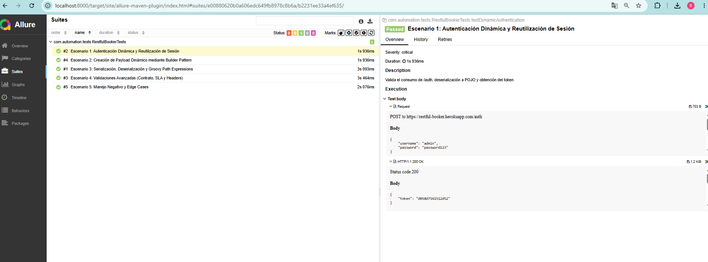

# 🚀 Restful-Booker API Automation Framework

Framework de pruebas automatizadas de tipo API testing desarrollado bajo estándares de la industria, utilizando **Java 21**, **Rest Assured**, **JUnit 5** y el patrón de diseño **Builder**, con integración completa de reportes avanzados mediante **Allure**.

---

## 🛠️ Tecnologías y Librerías Utilizadas

* **Java 21** (LTS) - Lenguaje de programación base.
* **Maven** - Gestor de dependencias y ciclo de vida del proyecto.
* **Rest Assured 5.x** - Biblioteca para pruebas y validación de servicios REST.
* **JUnit 5** - Motor de ejecución de pruebas unitarias y de integración.
* **Lombok** - Reducción de código repetitivo (Boilerplate) para los objetos de transferencia (POJOs).
* **Groovy / JsonPath** - Extracción y validación dinámica de payloads y contratos.
* **Allure Report (JUnit 5 Adapter & Maven Plugin)** - Generación de reportes de ejecución interactivos.

---

## 📂 Arquitectura del Proyecto

El proyecto está diseñado bajo una arquitectura modular y limpia, separando la lógica de negocio, los modelos de datos (POJOs), las configuraciones de especificaciones HTTP y las clases de prueba:

```text
restful-booker-automation/
│
├── .allure/                  # Configuración interna del CLI de Allure
├── allure-results/           # Archivos JSON y adjuntos generados en crudo por JUnit 5
├── src/
│   ├── main/java/            # Clases de utilidad, clientes HTTP y POJOs con Lombok
│   └── test/java/            # Clases de pruebas automatizadas (Escenarios 1 al 5)
├── target/                   # Directorio de compilación y reportes estáticos
│   └── site/
│       └── allure-maven-plugin/ # Reporte HTML generado listo para visualizar
├── pom.xml                   # Configuración de dependencias y plugins de Maven
└── README.md                 # Documentación del framework
```

---

## 🧪 Cobertura de Pruebas (5 Escenarios Clave)

El framework valida de extremo a extremo los flujos del sistema *Restful-Booker*:

1. **Escenario 1: Autenticación Dinámica y Reutilización de Sesión** - Generación de tokens de acceso válidos consumiendo el endpoint de autenticación.
2. **Escenario 2: Creación de Payload Dinámico mediante Builder Pattern** - Construcción robusta de reservas utilizando objetos inmutables y patrones de diseño modernos.
3. **Escenario 3: Serialización, Deserialización y Groovy Path Expressions** - Mapeo de objetos Java a JSON y validaciones avanzadas con expresiones personalizadas.
4. **Escenario 4: Validaciones Avanzadas (Contrato, SLA y Headers)** - Control de esquemas de respuesta, tiempos de respuesta esperados y validación de cabeceras HTTP.
5. **Escenario 5: Manejo Negativo y Edge Cases** - Pruebas de restricciones de seguridad (ej. `403 Forbidden` al actualizar sin token) y recursos inexistentes (`404 Not Found`).

---

## ⚙️ Instrucciones de Ejecución

### 1. Requisitos Previos de Instalación
Asegúrate de contar con lo siguiente configurado en tu entorno local:
* **Java 21 (JDK)** instalado y configurado en las variables de entorno (`JAVA_HOME`).
* **Maven** instalado y disponible en la consola.

### 2. Comandos de Consola para Ejecución de Pruebas
Puedes ejecutar la suite de pruebas completa utilizando los siguientes comandos según el entorno deseado:

* **Ejecución estándar:**
  ```powershell
  mvn clean test
  ```

* **Ejecución indicando el entorno de QA:**
  ```powershell
  mvn clean test -Denv=qa
  ```

---

## 📊 Generación y Visualización de Reportes Allure

El proyecto incluye soporte completo para Allure Report mediante JUnit 5 y Maven.

### Comando oficial para generar y abrir el reporte localmente:
Para levantar el servidor interactivo de Allure y visualizar los resultados de inmediato, ejecuta:
```powershell
mvn allure:serve
```

### Solución alternativa para visualizar el reporte estático (Evitando bloqueos CORS):
Si abres el archivo `index.html` directamente desde el explorador de archivos (`file://`), los navegadores bloquean la carga de datos por seguridad. Para solucionarlo utilizando un servidor local ultrarrápido:

1. Ubícate en la carpeta donde se encuentra el reporte compilado:
   ```powershell
   cd target/site/allure-maven-plugin
   ```
2. Levanta un servidor local con Python:
   ```powershell
   python -m http.server 8000
   ```
3. Abre tu navegador web e ingresa a la siguiente dirección:
   ```text
   http://localhost:8000
   ```

---
## 📸 Evidencia del Reporte de Allure

